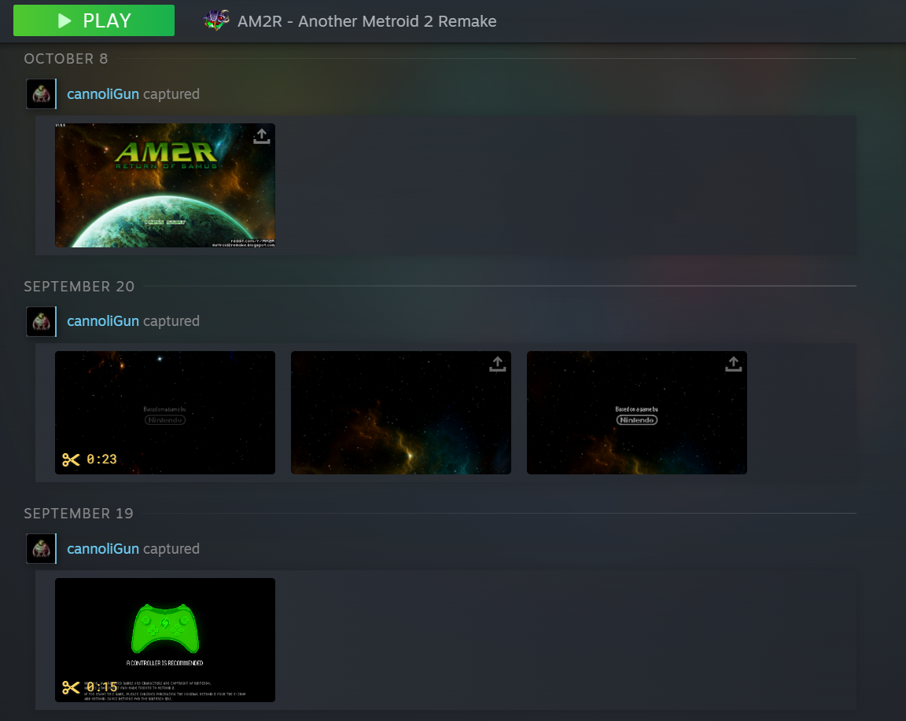

# Steam Captured Activity

A [Millennium](https://steambrew.app) plugin for the Steam client that puts the screenshots and recordings you
captured in each game's **Activity** feed, in Steam's own style.

## Features

- One card per day with captures, headlined **"{your name} captured"**.
- Your screenshots and clips as 16:9 cards, with clips playable in place and their length shown on the card.
- Works for Steam games **and** non-Steam games (shortcuts you added to your library).
- Works on the desktop and in Big Picture.

## Install

Requires [Millennium](https://steambrew.app).

1. Download `steam-captured-activity-<version>.zip` from the [latest release](../../releases).
2. Extract it into `<Steam>/millennium/plugins/`, so the plugin is in `<Steam>/millennium/plugins/steam-captured-activity`.
3. Restart Steam and enable **Steam Captured Activity** in the Millennium settings.

To update, replace that folder with the new release's.

## Settings

Open Steam's Millennium settings and pick **Steam Captured Activity**:

| Option | Default | What it does |
| --- | --- | --- |
| Steam games support | On | Your captures in the Activity feed of Steam games |
| Non-Steam games support | On | Your captures in the Activity feed of non-Steam games |

## Notes

- **Deleted captures:** the feed follows what Steam lists. When you delete a screenshot or a recording, it leaves the
  feed the next time you open that game's page, or within 5 minutes if the page stays open.
- **Many screenshots:** a game with more than 100 screenshots shows all of them.

## Support

If this plugin is useful to you, you can support its development on [Ko-fi](https://ko-fi.com/cannoligun).

## About

Shows the screenshots and recordings Steam captured in each game's Activity feed, as daily 16:9 cards with inline clip
playback, for Steam games and non-Steam shortcuts.

## License

MIT
