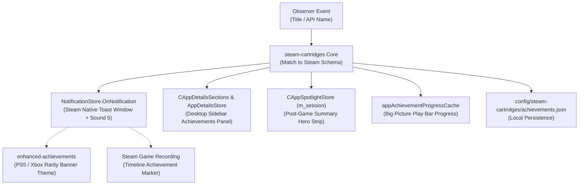

# Plan: Native Achievements for Non-Steam Games in steam-cartridges (Agnostic Architecture)

**Status:** Plan & Research Complete · Implementation Pending (Phase 5)
**Author:** Architect
**Goal:** Build an agnostic, Steam-focused architecture where any non-Steam game (e.g. *Jotunnslayer: Hordes of Hel* from Epic Games Store, GOG DRM-free releases, Godot/GameMaker/Unity/Unreal/Ren'Py titles, or local emulator/standalone setups) added to Steam mirrors its native Steam Store achievement schema, and when an achievement triggers during gameplay, an out-of-process observer detects it from local stored information, engine logs, or OS notifications and unlocks it in the native Steam UI (toast notification, desktop sidebar, post-game summary, and Big Picture play bar).

---

## 1. The Target User Experience

The workflow expected by the user:

1. **Add Shortcut to Steam:** The user adds *Jotunnslayer: Hordes of Hel* (or any non-Steam game) as a non-Steam shortcut.
2. **Mirror Native Data:** `steam-cartridges` automatically matches the shortcut to its Steam Store counterpart (AppID `2820820`). It mirrors the title, description, capsule art, category badges, and **the native Steam achievement schema** (titles, descriptions, locked/unlocked icons, rarity percentages).
3. **Launch & Launch Notification:** The user clicks "Play" in Steam.
   - When the game starts and `steam-cartridges` confirms achievement tracking is active, Steam displays a custom native launch toast:
     - Header: `{steam-cartridges icon} Local Achievements Enabled`
     - Body: `Enjoy your game!`
   - Controlled by a plugin setting: **Off** | **First game run** | **All game runs** (default).
4. **In-Game Trigger & Local Observation:** An in-game achievement unlocks. An agnostic observer detects the event in real-time from local files, databases, engine logs, or OS notifications.
5. **Native Steam Reaction:**
   - Steam displays the native achievement toast popup (`notificationtoasts_<n>_desktop` or Big Picture portal) and plays the native chime.
   - If `enhanced-achievements` is installed, it themes the banner (PS5/Xbox/Steam rarity tiers).
   - In Steam Game Recording, an achievement marker is placed on the active timeline.
   - The desktop Right-Column "Achievements" panel reflects the unlocked state with a live progress bar.
   - The Post-Game Summary hero banner displays the achievement card.
   - The Big Picture play bar under "Play" updates its completion ratio.

---

## 2. Reading Local Stored Information (The Agnostic Observers)

Rather than implementing 10 separate storefront APIs (no Epic OAuth, no EA app hooks, no Xbox REST endpoints), `steam-cartridges` reads **locally stored information** created on the player's PC:

```
+-----------------------------------------------------------------------------+
|                     LOCAL STORED DATA READERS FOR NON-STEAM GAMES           |
+-----------------------------------------------------------------------------+
| Reader 1: Steam Emulator Saves (Goldberg, CODEX, RUNE, GSE)                 |
|   - Paths: %appdata%\Goldberg SteamEmu Saves\<AppID>\achievements.json     |
|            %PUBLIC%\Documents\Steam\CODEX\<AppID>\achievements.ini       |
|            %appdata%\Steam\RUNE\<AppID>\achievements.ini                  |
|   - Event: FileSystemWatcher detects write; diffs unlocked achievements.    |
+-----------------------------------------------------------------------------+
| Reader 2: GOG Galaxy Local Database (galaxy-2.0.db)                         |
|   - Path: C:\ProgramData\GOG.com\Galaxy\storage\galaxy-2.0.db           |
|   - Format: Local SQLite table 'UserAchievements'                           |
|   - Event: Polled/read in read-only WAL mode while the game runs.           |
+-----------------------------------------------------------------------------+
| Reader 3: Multi-Engine Runtime Log & Data Tailers                           |
|   - Unity:     %USERPROFILE%\AppData\LocalLow\[Company]\[Game]\Player.log  |
|   - Unreal:    %LOCALAPPDATA%\[Game]\Saved\Logs\[Game].log                 |
|   - Godot:     %APPDATA%\Godot\app_userdata\[Game]\logs\godot.log          |
|   - GameMaker: %LOCALAPPDATA%\[Game]\ (save.ini / debug.log / save.json)   |
|   - Ren'Py:    %APPDATA%\RenPy\[Game]\log.txt & persistent                   |
|   - Event: Real-time engine log tailer & save file diffing.                 |
+-----------------------------------------------------------------------------+
| Reader 4: Windows OS Notification Listener (Storefront Toast Observer)     |
|   - Source: Epic Games Launcher, Xbox App, EA App                           |
|   - Mechanism: Windows.UI.Notifications.Management.UserNotificationListener |
|   - Event: Intercepts desktop toast, matches title to mirrored Steam schema.|
+-----------------------------------------------------------------------------+
| Reader 5: Pure Standalone DRM-Free Save Files                               |
|   - Paths: %USERPROFILE%\Saved Games\, %LOCALAPPDATA%\                   |
|   - Format: JSON / XML / SQLite save file progress diffs.                   |
+-----------------------------------------------------------------------------+
| Reader 6: Local Test & Mock RPC Trigger (Instant Verification)              |
|   - Direct Millennium RPC & Settings UI button to trigger any unlock.       |
+-----------------------------------------------------------------------------+
```

---

## 3. Deep-Dive on Multi-Engine & Storefront Scenarios

### 3.1 Multi-Engine Detection Matrix (Unity, Unreal, Godot, GameMaker, Ren'Py)

When a non-Steam game launches, `steam-cartridges` inspects its folder signature (0ms cost, done once on boot) to identify the game engine and attach the appropriate local observer:

| Engine | Identifying Signatures | Default Local Log / Data Path on Windows | Format & Detection Strategy |
| :--- | :--- | :--- | :--- |
| **Unity** | `UnityPlayer.dll`, `*_Data/` | `%USERPROFILE%\AppData\LocalLow\[Company]\[Product]\Player.log` | Text log tailer; detects `UnlockAchievements` or custom achievement prints. |
| **Unreal Engine** | `Engine/Binaries/`, `*Unreal*.exe` | `%LOCALAPPDATA%\[Project]\Saved\Logs\[Project].log` | Text log tailer; detects `LogOnline: OSS: UnlockAchievement` lines. |
| **Godot Engine** | `*.pck`, Godot PE header | `%APPDATA%\Godot\app_userdata\[Project]\logs\godot.log` (or `user://`) | Text log tailer + watches `%APPDATA%\Godot\app_userdata\[Project]\` for save/achievement updates. |
| **GameMaker** | `data.win`, `options.ini` | `%LOCALAPPDATA%\[Project]\` | Sandbox directory watcher; parses `save.ini`, `save.json`, or `achievements.ini` changes in real-time. |
| **Ren'Py** | `renpy/` folder, `lib/` | `%APPDATA%\RenPy\[Project]\log.txt` & `persistent` | Watches Ren'Py persistent achievement state and debug log lines. |
| **Custom / Monogame / FNA** | `.NET` / custom binaries | `%LOCALAPPDATA%\[Game]\` or `%USERPROFILE%\Saved Games\[Game]\` | Save file watcher (JSON/XML diffs). |

#### Why Godot is Especially Friendly
1. **Standardized User Directory:** Godot routes all project storage to `user://`, which maps deterministically on Windows to `%APPDATA%\Godot\app_userdata\[project_name]\`.
2. **Unified Logging:** In Godot 3 and Godot 4, engine logging is enabled by default to `logs/godot.log`. When a game unlocks an achievement (whether via GodotSteam, custom script, or EOS), `print()` statements and errors go directly to `godot.log`.
3. **Local Saves:** Most Godot indie games (e.g. *Brotato*, *Cassette Beasts*, *Buckshot Roulette*) store unencrypted JSON or CFG saves directly in `user://`.

#### Why GameMaker is Especially Friendly
GameMaker executes in a strict Windows local sandbox at `%LOCALAPPDATA%\[Project_Name]\`. In DRM-free releases (e.g. *Undertale*, *Hotline Miami*, *Pizza Tower*, *Katana Zero*), achievement state is written into plain-text `.ini` or `.json` files inside this sandbox. Watching this single directory captures unlocks instantly.

---

### 3.2 Steam Emulator Saves (The FederalSpy Pattern)
- **How it works:** Emulators (Goldberg, CODEX, RUNE, GSE, DarkSiders, Skidrow) provide a drop-in `steam_api64.dll` that emulates Steamworks locally.
- **On disk:**
  - Goldberg writes `%appdata%\Goldberg SteamEmu Saves\<AppID>\achievements.json`:
    ```json
    [
      { "name": "ACH_FIRST_KILL", "earned": true, "earned_time": 1727364800 }
    ]
    ```
  - CODEX and RUNE write `.ini` files:
    ```ini
    [Achievements]
    ACH_FIRST_KILL=1
    ```
- **Observer:** `steam-cartridges` watches these directories for `<AppID>`. On write, it parses the diff in `< 50ms` and fires the Steam native toast.

---

### 3.3 GOG DRM-Free Games (Local SQLite Database)
- **Local Database Path:**
  ```
  C:\ProgramData\GOG.com\Galaxy\storage\galaxy-2.0.db
  ```
- **How it works:** When GOG Galaxy is installed, GOG records all achievement unlocks locally in an SQLite database.
- **SQL Query:**
  ```sql
  SELECT apikey AS ApiKey, unlockTime AS UnlockTime, isUnlocked AS IsUnlocked
  FROM UserAchievements
  WHERE gameReleaseKey = ?;
  ```
- **Observer:** `steam-cartridges` opens a read-only SQLite connection (`SQLITE_OPEN_READONLY | SQLITE_OPEN_WAL`) while the GOG shortcut runs. When `isUnlocked = 1`, it immediately fires the Steam native toast.
- **Zero Network:** Zero GOG account credentials, zero OAuth tokens, works offline.

---

### 3.4 The Epic Games Store Case (*Jotunnslayer: Hordes of Hel*) & Notification Suppression
When playing an Epic game added to Steam:

1. **How to get ONLY Steam notifications (Disabling Epic's Popups):**
   - **Option A (Disable Epic Overlay Popups):**
     - In Epic In-Game Overlay (`Shift + F3` $	o$ Settings), turn off overlay notifications.
     - Epic stops drawing its on-screen banner over the game.
     - In Windows Settings $	o$ System $	o$ Notifications $	o$ Epic Games Launcher, turn **Sound: Off** and **Banners: Off**.
     - Epic Launcher still posts notifications to the OS notification database, where our Windows `UserNotificationListener` catches it and displays the **native Steam toast** with the Steam chime!
   - **Option B (Engine Log Tailer):**
     - *Jotunnslayer: Hordes of Hel* is built on the Unity engine.
     - Unity writes real-time execution logs to `%USERPROFILE%\AppData\LocalLow\Grindstone\Jotunnslayer\Player.log`.
     - When an achievement condition triggers, Unity engine / EOS logs the unlock.
     - `steam-cartridges` tails `Player.log` and fires the Steam notification directly from disk without touching Epic's UI.
   - **Option C (Local Steamworks Shim):**
     - If the game folder contains or accepts `steam_api64.dll`, placing a Goldberg `steam_api64.dll` causes the game to write to `%appdata%\Goldberg SteamEmu Saves\2820820\achievements.json`.
     - 100% offline, zero Epic UI interaction.

---

## 4. Feature: "Local Achievements Enabled" Launch Notification

To give the player confidence that achievements are actively tracked as soon as their game boots:

### 4.1 Visual & Audio Design
- **Headline / Title:** `{steam-cartridges icon} Local Achievements Enabled`
- **Body Text:** `Enjoy your game!`
- **Icon:** Bundled `steam-cartridges` cartridge glyph / badge icon.
- **Audio:** Steam's subtle navigation chime.

### 4.2 Configuration Setting (`settings.ts`)
Add a new setting row in the Millennium plugin settings:

| Setting Key | Label | Options | Default | Description |
| :--- | :--- | :--- | :--- | :--- |
| `localAchievementsNotifyOnLaunch` | Launch Notification | `off`, `first_run`, `all_runs` | `all_runs` | Show a Steam notification on game start when local achievement tracking is active. |

- **`off`:** Never show the startup toast.
- **`first_run`:** Show only the very first time this specific game is launched with achievement tracking enabled. (Tracked in `config/steam-cartridges/achievements.json` under `"acknowledged_games": []`).
- **`all_runs`:** Display on every game boot.

### 4.3 Trigger Timing
1. Hook into Steam's game process launch event (`SteamClient.Apps.RegisterForGameActionTracker`).
2. Verify that:
   - The launched game is a non-Steam shortcut.
   - A valid Steam achievement schema is mirrored for this shortcut.
   - At least one active observer channel (file watcher, GOG DB, engine log tailer, or notification listener) is ready.
   - The user's launch notification setting allows the toast.
3. Dispatch the toast via `NotificationStore.OnNotification` or Steam's custom toast portal in `SharedJSContext`.

---

## 5. The Steam Native Sink Pipeline (Rendering & Audio)

Regardless of which channel observes the unlock, the payload flows into **Steam's own native sinks**:



### 5.1 Steam Native Toast & Chime
In `SharedJSContext`:
```ts
const store = window.NotificationStore;
const config = store.m_rgNotificationTypeConfigs[achievementType]; // CClientNotificationAchievement

const payload = config.proto.fromObject({
    appid: shortcutAppId,
    achievement_id: achievementId,
    name: achievementTitle,
    description: achievementDescription,
    image_url: iconUrl,
    achieved: true,
    rtime_unlocked: Math.floor(Date.now() / 1000),
    global_achieved_pct: rarityPct
});

store.OnNotification(store.m_nNextTestNotificationID++, achievementType, payload.serializeBinary());
```

### 5.2 Desktop Right-Column Panel
1. In `steam-cartridges/frontend/steam/sections.ts`, re-enable `"achievements"` in `GetSections()`.
2. Hook `AppDetailsStore.GetAchievements(shortcutAppId)` to return:
   ```ts
   {
       nTotal: schema.total,
       nAchieved: unlockedList.length,
       vecHighlight: unlockedList.slice(0, 5),
       vecAchieved: unlockedList,
       vecUnachieved: lockedList
   }
   ```
   Steam natively renders the completion percentage bar, highlighted badges, and locked list.

### 5.3 Post-Game Summary Hero Banner
In `CAppSpotlightStore` (module `74827`):
```ts
const appData = spotlightStore.GetOrCreateAppData(shortcutAppId);
if (appData?.m_session) {
    appData.m_session.AddAchievement({
        strID: achievementId,
        strName: achievementTitle,
        strDescription: achievementDescription,
        strImage: iconUrl,
        bAchieved: true,
        rtUnlocked: Math.floor(Date.now() / 1000)
    }, Date.now());
}
```

### 5.4 Big Picture Play Bar
```ts
window.appAchievementProgressCache.m_achievementProgress.mapCache.set(shortcutAppId, {
    unlocked: unlockedList.length,
    total: schema.total,
    all_unlocked: unlockedList.length === schema.total
});
```

---

## 6. Implementation Roadmap (Phase 5)

Implementation is split into 6 mechanical steps:

### Step 1: Local Schema Cache & State Storage
- **File:** `steam-cartridges/backend/achievements_store.lua` & `frontend/features/achievements/`
- Ingest Steam achievement schema for mapped AppID (`2820820` for Jotunnslayer).
- Persist local unlocks and settings in `<steam>/millennium/config/steam-cartridges/achievements.json`.

### Step 2: Native UI Store Feeding
- **Files:** `frontend/steam/sections.ts`, `frontend/features/achievements/store-feed.ts`
- Include `"achievements"` in `RESTORED_SECTIONS`.
- Wrap `AppDetailsStore.GetAchievements` to serve mapped shortcut records.
- Update `appAchievementProgressCache` on route navigation.

### Step 3: Game-Launch Notification ("Local Achievements Enabled")
- **Files:** `frontend/features/achievements/launch-toast.ts`, `frontend/settings/settings.ts`
- Implement setting `localAchievementsNotifyOnLaunch` (`off`, `first_run`, `all_runs`).
- On shortcut launch, verify observer readiness and dispatch the `{steam-cartridges} Local Achievements Enabled` toast.

### Step 4: Local Test / Fake Trigger (Verification Baseline)
- **Files:** `backend/achievements_rpc.lua`, `frontend/features/achievements/trigger.ts`
- Implement Millennium RPC `cartridges:trigger_achievement(shortcutAppId, achievementId)`.
- Dispatches `NotificationStore.OnNotification`, updates local state, and refreshes the desktop panel.
- Add a "Test Unlock" action in the settings panel for instant verification.

### Step 5: The Multi-Engine In-Game Observer Engine
- **File:** `backend/achievements_observer.lua`
- Detects when a non-Steam shortcut process launches.
- Inspects the game folder to identify the engine (Unity, Unreal, Godot, GameMaker, Ren'Py, Steamworks shim).
- Attaches the appropriate local observer:
  1. File watcher on local save / emulator directories (Goldberg, CODEX, RUNE, GameMaker sandbox).
  2. GOG Galaxy SQLite database reader (`galaxy-2.0.db`).
  3. Real-time log tailer for the detected engine (`Player.log`, `godot.log`, `Saved/Logs`).
  4. Windows notification listener for launcher toasts.
- Upon detecting an unlock, emits an RPC event to frontend `on_achievement_unlocked`.

### Step 6: Post-Game Summary Integration
- Pushes unlocked achievements into `m_session.AddAchievement` so they appear on the hero card strip when the player exits the game.

---

## 7. Verification & Exit Criteria

1. **Launch Notification Verification:**
   - Launch *Jotunnslayer: Hordes of Hel* from Steam.
   - PASS: Steam displays `{steam-cartridges icon} Local Achievements Enabled - Enjoy your game!` toast.
   - PASS: Changing setting to `off` silences the launch toast.
   - PASS: Changing setting to `first_run` displays it only once per game.
2. **Test Trigger Verification:**
   - Execute `node scratch/test_fake_achievement.mjs 2315502503 ACH_WIN_RUN`.
   - PASS: Native Steam popup toast appears with icon, title, and chime.
   - PASS: `AppDetailsStore.GetAchievements(2315502503).nAchieved` increments.
   - PASS: Big Picture Play bar updates progress count.
3. **In-Game Playthrough Verification:**
   - Play the non-Steam game and trigger an achievement.
   - PASS: Observer detects the event locally and emits the native Steam toast during active gameplay.
   - PASS: Post-Game Summary card strip displays the unlocked achievement upon game exit.
4. **Enhanced Achievements Compatibility:**
   - With `enhanced-achievements` active, verify that non-Steam shortcut unlocks trigger the styled PS5/Xbox banner and rarity sound without regression.
